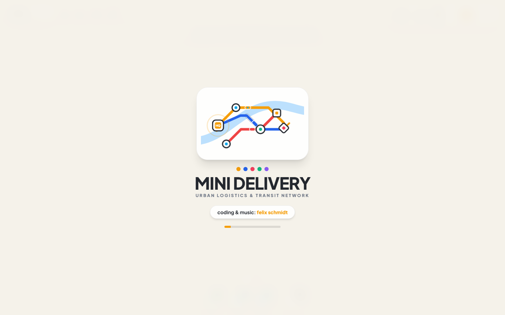
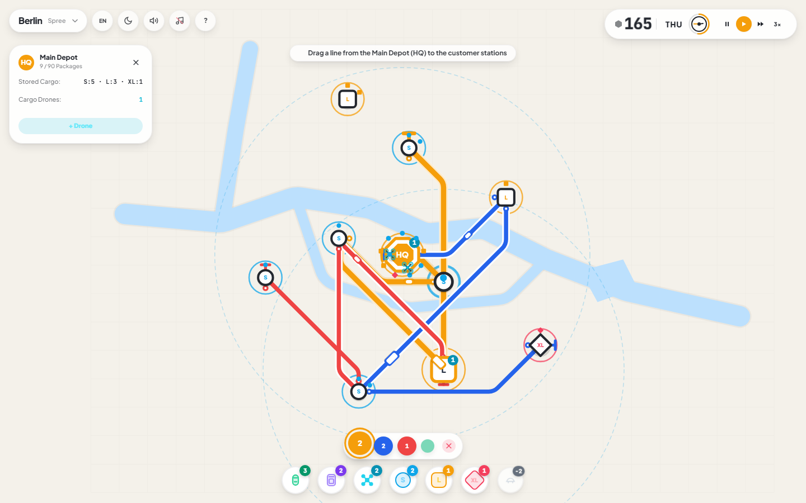
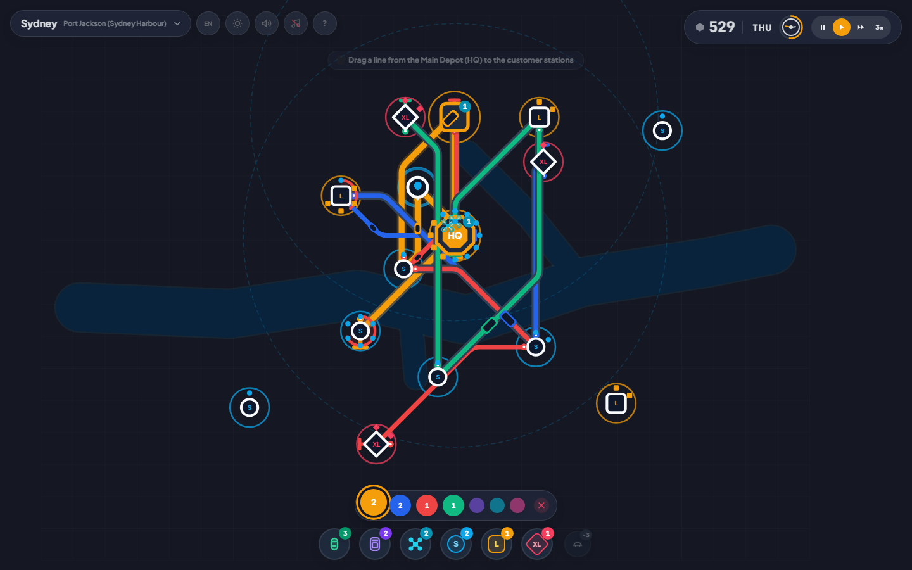
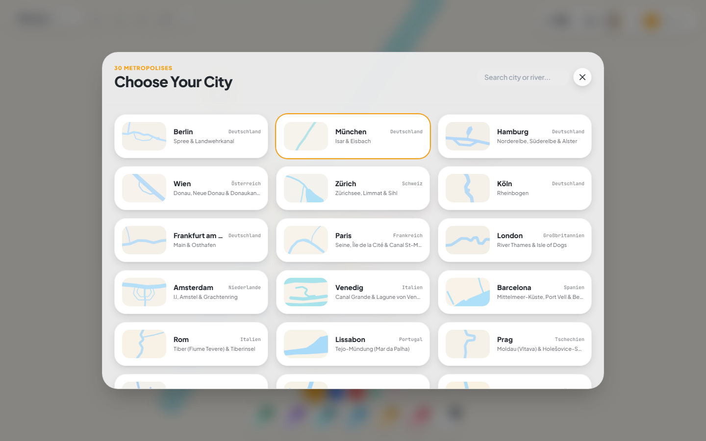
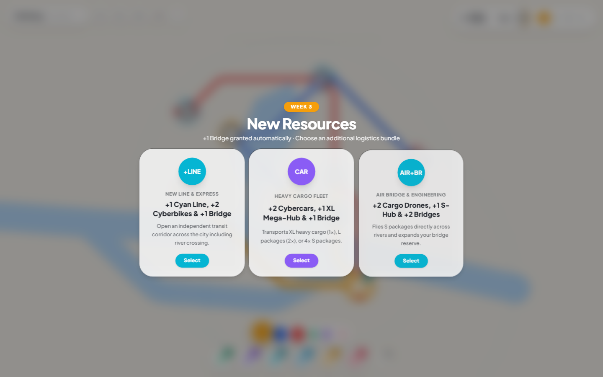
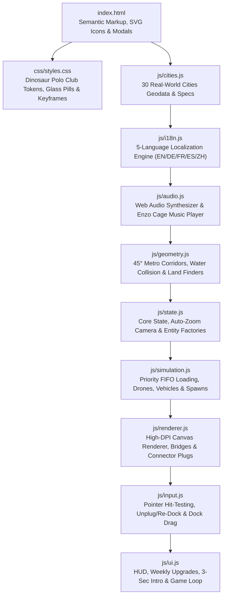

# 📦 MINI DELIVERY — Urban Logistics & Transit Simulation

[](https://enzocage.github.io/mini-delivery/)
[](#multilingual-support-en--de--fr--es--中文)
[](#30-real-world-metropolises)
[](#procedural-audio--background-music)

> **coding & music: felix schmidt**

**MINI DELIVERY** is a minimalist, tactile urban logistics and transit network strategy game inspired by the iconic design philosophy of Dinosaur Polo Club's *Mini Metro* and *Mini Motorways*. Start in a calm, tightly framed city center with just a single Main Depot and two nearby stations—and scale your multi-modal delivery network of **45° transit corridors**, **Cyberbikes**, **Heavy-Duty Cybercars**, **Cargo Drones**, **River Bridges**, and **S / L / XL Transfer Hubs** as the camera smoothly zooms out into a bustling, late-game metropolis.

---

## 🖼️ Screenshots

### 1. Animated 3-Second Network Intro Screen


### 2. Day Mode — Multi-Line Urban Logistics in Berlin


### 3. Night Mode — Late-Game High-Density Metropolis & Rush Hour


### 4. 30 Real-World Metropolises with Authentic River & Coastline Geodata


### 5. Weekly Resource Bundles & Progressive Unlocks


---

## ✨ Key Features & Game Design

### 🎯 3-Act Dramaturgical Arc: Win & Lose Conditions
- **Minimalist Opening (Day 1):** Begin closely zoomed in (`1.75×`) on the city center with **1 Main Depot (`HQ`, capacity 24)**, **2 nearby `S`-Customer Stations**, **2 Colored Logistics Lines**, **2 Cyberbikes**, **1 Bridge**, and **1 Cargo Drone**.
- **3-Star City Mastery Win Condition (`100` ★ / `220` ★★ / `350` ★★★ Deliveries):**
  - **★☆☆ Bronze (`100` Deliveries):** Master the initial urban core and first `L` parcels.
  - **★★☆ Silver (`220` Deliveries):** Survive cross-river sprawl, daily **Rush Hour waves (`16:00–20:00`)**, and heavy `XL` freight hubs.
  - **★★★ Gold Victory (`350` Deliveries):** Master peak metropolis density! Unlocks the **Metropolis Mastered (`★★★`)** victory screen, saves your city medal & best score to `localStorage` (shown in the 30-City Browser), and lets you advance to the **Next Metropolis** or continue into **Highscore Overtime**.
- **Dual Lose Conditions (Real Tactical Stakes):**
  1. **Customer Station Overload:** As soon as an `S`/`L` station accumulates **4 waiting orders** (or **3 waiting orders** at an `XL` station), a pulsing red countdown ring begins ticking (`~22s` down to `~6.5s` under heavy backlog). Delivering a single parcel buys only a brief `-14%` breather—you must bring the queue below threshold to clear the alarm!
  2. **Depot / Hub Gridlock:** If your lines fail to drain cargo fast enough and any **Main Depot (`HQ`, cap 24)** or **Transfer Hub (`S: 6`, `L: 12`, `XL: 20`)** exceeds **85% capacity**, the depot itself enters a red Gridlock Countdown!
- **Automatic Director Camera:** No manual panning required—the camera automatically frames all active stations and smoothly zooms out (`1.75× → 0.58×`) using critically damped interpolation as new districts emerge across the map.

---

## 🚚 Multi-Modal Package Classes, Vehicles & Hubs

### Package Classes (Shape-Coded)
| Shape | Class | Weight / Type | Appears From | Compatible Vehicles | Compatible Hubs |
| :---: | :---: | :--- | :--- | :--- | :--- |
| 🔵 **Circle** | **`S`** | Light Parcel | Day 1 (Week 1) | **Cargo Drone** (`1×` Air), **Cyberbike** (`2×`), **Cybercar** (`4×`) | `HQ`, `S`-Hub, `L`-Hub, `XL`-Hub |
| 🟧 **Square** | **`L`** | Medium Parcel | Day 4 (Mid-Week 1) | **Cyberbike** (`1×`), **Cybercar** (`2×`) *(Too heavy for drones!)* | `HQ`, `L`-Hub, `XL`-Hub |
| 🔺 **Diamond** | **`XL`** | Heavy Freight | Week 2+ | **Cybercar** (`1×` only!) | `HQ`, `XL` Mega-Hub |

### Fleet & Infrastructure Tokens (Bottom Dock)
- **🟢 Cyberbike (`bike`):** High-speed ground courier (`speed: 96`). Carries up to **2× `S`** or **1× `L`** package along any colored line.
- **🟣 Cybercar (`car`):** Heavy-duty ground transporter (`speed: 76`). Carries **1× `XL`**, **2× `L`**, or **4× `S`** packages. Automatically unlocked and granted when the first `XL` station spawns.
- **🔵 Cargo Drone (`drone`):** Autonomous air courier (`speed: 128`). Stationed at any Depot (`HQ`, `S`, `L`, `XL`), flying **`S` packages** in a direct line across rivers and bays to customer stations or relay hubs within its radar range.
- **🏠 Intermediate Transfer Hubs (`depot_S`, `depot_L`, `depot_XL`):** Placeable on any dry land to build **Hub-and-Spoke** networks. Ground lines can drop off packages at a regional hub so stationed Cargo Drones or secondary lines can complete the last-mile delivery across water.
- **🌉 Bridges (`bridges`):** Automatically consumed when a 45° line segment crosses a river or bay, and immediately refunded to your inventory when a line is unplugged or dismantled.

---

## 🔌 Tactile Line Drawing, Unplugging & Re-Docking UX

Inspired by *Mini Metro* and *Mini Motorways*, every line is a physical, elastic object that can be reshaped at any time:
1. **Draw & Extend Lines:** Drag directly from any Depot or Station to another Station to create sleek 45°-knee transit corridors with automatic parallel lane separation on shared segments.
2. **Grab Connector Plugs ("Verbindungsstellen"):** Every station displays tactile colored **Connector Plugs** on its perimeter where a line docks. Grab any connector plug to immediately **unplug** that station (`reroute_end` for endpoints, `reroute_mid` for intermediate stops) and magnetically **re-dock** the line onto any other station—while keeping all vehicles on the line intact.
3. **T-Bar Terminals (`⊢`) & Pull-Back Unplugging:** Grab the iconic `⊢` terminal cap at either end of a line to extend it outward, or pull backward toward the previous station to detach the endpoint on the fly.
4. **Direct Dock Drag-and-Drop:** Drag **Cyberbikes**, **Cybercars**, **Cargo Drones**, and **S / L / XL Hubs** directly from the bottom token dock onto lines, depots, or open land.

---

## 📱 High-End Invisible Mobile Touch Controls

Designed with zero on-screen joysticks or visual clutter—matching the flagship mobile feel of *Mini Metro* and *Mini Motorways*:

| Invisible Gesture / Feature | Behavior |
| :--- | :--- |
| **Zoom-Compensated Hit Expansion** | Touch targets for stations, connector plugs, `⊢` T-Bars, and line segments automatically expand by `1.75×` (scaled inversely with camera zoom) for effortless fat-finger accuracy. |
| **Finger-Occlusion Lift & Tether** | Dragging any token (`Bike`, `Car`, `Drone`, `S/L/XL Hub`) from the bottom dock lifts the placement preview `36px` above your fingertip with a delicate dotted tether so your thumb never obscures the target. |
| **2-Finger Pinch-to-Zoom & Pan** | Pinch and pan anywhere with two fingers (`0.46×` – `2.65×` zoom) to inspect dense inner-city interchanges; smoothly glides back to the Auto-Director framing after inactivity. |
| **1-Finger Empty-Canvas Pan** | Touch and drag on any open land or water to pan the camera with one thumb. |
| **Double-Tap on Empty Map** | Instantly glides the camera back to the automatic city-framing view (`Auto-Camera Centered`). |
| **2-Finger Quick Tap** | Tap anywhere with two fingers to toggle **Pause / Resume** (`⏸` / `▶`) without reaching for the top-right clock. |
| **Long-Press (420ms) on Station** | Hold a finger on any Depot to open its live cargo/drone inspector, or on a Customer Station to highlight and select its serving line. |
| **Swipe on Bottom Line Bar** | Swipe horizontally across the bottom line pill bar to cycle through unlocked lines with tactile haptic ticks (`navigator.vibrate`). |

---

## 🌐 Multilingual Support (`EN` / `DE` / `FR` / `ES` / `中文`)

**English (`EN`)** is configured as the default language out of the box. Click the **`EN`** globe button in the top-left utility bar at any time to cycle live through all **5 complete localizations** without reloading or losing game progress:

| Code | Language | Day Labels | Example Line Names |
| :---: | :--- | :--- | :--- |
| **`EN`** *(Default)* | **English** | `MON` – `SUN` | Amber Line, Cobalt Line, Coral Line, Emerald Line |
| **`DE`** | **Deutsch** | `MO` – `SO` | Gelb-Linie, Kobalt-Linie, Korall-Linie, Smaragd-Linie |
| **`FR`** | **Français** | `LUN` – `DIM` | Ligne Ambre, Ligne Cobalt, Ligne Corail, Ligne Émeraude |
| **`ES`** | **Español** | `LUN` – `DOM` | Línea Ámbar, Línea Cobalto, Línea Coral, Línea Esmeralda |
| **`中文`** | **简体中文** | `周一` – `周日` | 琥珀线, 钴蓝线, 珊瑚线, 翡翠线 |

You can also deep-link directly into a specific language via URL query parameter, e.g. `?lang=de`, `?lang=fr`, `?lang=es`, or `?lang=zh`.

---

## 🎵 Procedural Audio & Background Music

- **Procedural Web Audio Synthesizer ([`js/audio.js`](js/audio.js)):** Every package pickup, delivery (`S` / `L` / `XL`), bridge construction, station spawn, and weekly upgrade chord generates harmonic pentatonic/C-major-9th sine & triangle tones in real time (inspired by Disasterpeace's *Mini Metro* audio design).
- **Optional Background Soundtrack (`♪` Button):** Click the musical note icon in the top-left utility bar to toggle the ambient electronic background track **`Enzo Cage – Bright`** (`https://www.enzocage.de/mp3/enzo_cage_sinus/enzo_cage_bright.mp3`), composed by **Felix Schmidt**.

---

## 🌍 30 Real-World Metropolises

Every city features custom Day & Night cartographic color palettes and normalized vector river/bay polygons (`[0..1000] × [0..650]`):

| # | City | Country | Waterway / Coastline | # | City | Country | Waterway / Coastline |
| :-: | :--- | :--- | :--- | :-: | :--- | :--- | :--- |
| 1 | **Berlin** | Germany | Spree & Landwehrkanal | 16 | **Budapest** | Hungary | Danube & Margaret Island |
| 2 | **Paris** | France | Seine & Île de la Cité | 17 | **Warsaw** | Poland | Vistula (Wisła) |
| 3 | **London** | UK | River Thames (Isle of Dogs) | 18 | **Lisbon** | Portugal | Tagus Estuary (Tejo) |
| 4 | **New York** | USA | Hudson, East River & Bay | 19 | **Dublin** | Ireland | River Liffey & Dublin Bay |
| 5 | **Tokyo** | Japan | Sumida, Arakawa & Tokyo Bay | 20 | **Stockholm** | Sweden | Lake Mälaren & Archipelago |
| 6 | **Hamburg** | Germany | Elbe, Norderelbe & Alster | 21 | **Istanbul** | Turkey | Bosphorus & Golden Horn |
| 7 | **Frankfurt** | Germany | Main & Osthafen | 22 | **Cairo** | Egypt | Nile & Gezira Island |
| 8 | **Munich** | Germany | Isar & Museumsinsel | 23 | **Dubai** | UAE | Dubai Creek & Persian Gulf |
| 9 | **Cologne** | Germany | Rhine (Rheinbogen) | 24 | **Mumbai** | India | Arabian Sea & Thane Creek |
| 10 | **Vienna** | Austria | Danube & Donaukanal | 25 | **Bangkok** | Thailand | Chao Phraya Meander |
| 11 | **Zurich** | Switzerland | Limmat, Sihl & Lake Zurich | 26 | **Singapore** | Singapore | Singapore River & Marina Bay |
| 12 | **Amsterdam** | Netherlands | IJ & Grachtengürtel | 27 | **Seoul** | South Korea | Han River (Hangang) |
| 13 | **Venice** | Italy | Canal Grande & Giudecca | 28 | **Shanghai** | China | Huangpu & Suzhou Creek |
| 14 | **Rome** | Italy | Tiber & Isola Tiberina | 29 | **Hong Kong** | China | Victoria Harbour |
| 15 | **Prague** | Czechia | Vltava (Moldau) | 30 | **Sydney / SF / Chicago / Rio** | Global | Port Jackson, Golden Gate, Chicago River, Guanabara Bay |

---

## 🏗️ Modular Project Architecture

The codebase is cleanly factored into zero-dependency browser modules that work both via local `file://` double-click and on GitHub Pages (`https://`) without a build step:



### File Overview
- [`index.html`](index.html) — Main entry point, 3-second animated SVG intro splash screen, top HUD bars, bottom circular token dock, and modal dialogs.
- [`css/styles.css`](css/styles.css) — Custom properties for Day/Night cartographic palettes, tactile circular token animations, and responsive glassmorphism pills.
- [`js/cities.js`](js/cities.js) — Normalized river polylines, water polygons, and day/night palettes for all 30 cities plus `LINE_COLORS`, `DEPOT_SPECS`, and `VEHICLE_SPECS`.
- [`js/i18n.js`](js/i18n.js) — Full dictionary and DOM reactive translation helper (`t()`, `applyTranslationsToDOM()`) for English (default), German, French, Spanish, and Chinese.
- [`js/audio.js`](js/audio.js) — `SoundEngine` procedural Web Audio API synthesizer and `bgMusic` controller for `enzo_cage_bright.mp3`.
- [`js/geometry.js`](js/geometry.js) — 45° waypoint solver (`computeMetroWaypoints`), parallel track offset (`getSegmentParallelOffset`), connector/T-Bar coordinate math, and river-crossing checks.
- [`js/state.js`](js/state.js) — Central `state` store, critically damped auto-zoom camera (`updateAutoCamera`), `initCity()`, and bridge accounting (`recalculateLineBridges`).
- [`js/simulation.js`](js/simulation.js) — Urgency-sorted FIFO package loading (`handleVehicleStopAtNode`), drone relay AI (`updateDrones`), river-aware station spawning, and overcrowding timers.
- [`js/renderer.js`](js/renderer.js) — High-DPI HTML5 Canvas vector rendering (`renderGame`, `renderMiniMapPreview`).
- [`js/input.js`](js/input.js) — Unified pointer/touch state machine supporting line drawing, connector unplugging (`unplugStationFromLine`), segment bending, and dock token drag-and-drop.
- [`js/ui.js`](js/ui.js) — Top/bottom HUD synchronization, 3-card weekly upgrade modal, 30-city browser, node inspector, and main animation loop.

---

## 🚀 Running Locally

No build tools or package installations are required:
1. **Direct Browser Open:** Double-click [`index.html`](index.html) in any modern browser (Chrome, Edge, Firefox, Safari).
2. **Local Static Server (Optional):**
   ```bash
   npx serve .
   # or
   python -m http.server 8080
   ```

---

## 👤 Credits

- **Coding & Music:** **Felix Schmidt** ([enzocage.de](https://www.enzocage.de))
- **Background Track:** *Enzo Cage – Bright* (`enzo_cage_bright.mp3`)
- **Visual & Gameplay Inspiration:** *Mini Metro* & *Mini Motorways* by Dinosaur Polo Club
